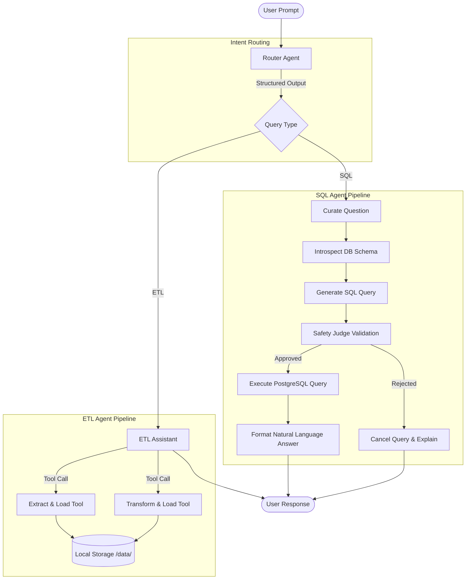

# 🤖 Data Agent — Multi-Agent System for SQL & ETL

An intelligent, production-ready multi-agent data assistant built with **LangGraph**, **LangChain**, and **PostgreSQL**. The system automatically classifies natural language questions and routes them to specialized sub-agents for automated SQL analytics and ETL data pipelines.

---

## 📋 Table of Contents

- [Overview](#-overview)
- [System Architecture](#-system-architecture)
- [Project Layout](#-project-layout)
- [Prerequisites](#-prerequisites)
- [Installation & Quickstart](#-installation--quickstart)
- [Configuration](#-configuration)
- [Agent Workflows](#-agent-workflows)
  - [1. Router Agent](#1-router-agent)
  - [2. SQL Agent](#2-sql-agent)
  - [3. ETL Agent](#3-etl-agent)
- [Database Schema & Seeding](#-database-schema--seeding)
- [Safety & Query Validation](#-safety--query-validation)
- [Extending the System](#-extending-the-system)
- [License](#-license)

---

## 🎯 Overview

The **Data Agent** acts as an autonomous data engineer and analyst. Instead of requiring manual SQL authoring or custom ETL scripting, users ask questions in natural language. The system dynamically:

1. **Understands Intent**: Uses structured LLM reasoning to determine if the query requires database analysis (SQL) or data ingestion/transformation (ETL).
2. **Translates & Validates**: Generates syntactically correct PostgreSQL queries against dynamic schema introspections, guarded by an automated LLM security judge.
3. **Executes & Formats**: Safely queries the database or performs Pandas transformations, returning concise, human-readable insights.

---

## 🏗️ System Architecture



---

## 📁 Project Layout

```
.
├── agents/
│   ├── __init__.py
│   ├── router_agent.py      # Master supervisor graph and intent routing
│   ├── sql_agent.py         # SQL curation, generation, validation, and execution
│   └── etl_agent.py         # REST extraction, pandas transform, and loading tools
│
├── models/
│   ├── __init__.py
│   └── schemas.py           # Pydantic schemas for state graphs and structured outputs
│
├── utils/
│   ├── __init__.py
│   ├── db_manager.py        # Database connection pool and schema introspection
│   ├── data_tools.py        # Extraction, transformation context, and execution utilities
│   └── model_provider.py    # Multi-tier LLM selection (OpenAI / Anthropic)
│
├── data/                    # Datasets and generated extraction/transform outputs
│   ├── extract/             # Ingested API outputs
│   ├── transform/           # Processed datasets
│   ├── payments.csv
│   ├── ratings.csv
│   ├── rides.csv
│   ├── users.csv
│   └── vehicles.csv
│
├── .env.example             # Template for required environment variables
├── .gitignore               # Ignored environments, keys, and cache artifacts
├── main.py                  # Primary application entry point
├── pyproject.toml           # Project dependencies and packaging metadata
├── requirements.txt         # Pinned pip requirements
├── sample_schema.txt        # Reference database schema export
└── seed_database.py         # Automated database table creation and CSV seeder
```

---

## ⚙️ Prerequisites

- **Python**: 3.12 or newer
- **PostgreSQL**: 14+ running locally or in the cloud
- **LLM API Keys**:
  - OpenAI API Key (`OPENAI_API_KEY`)
  - Anthropic API Key (`ANTHROPIC_API_KEY`)

---

## 🚀 Installation & Quickstart

### 1. Clone & Set Up Virtual Environment

```bash
python -m venv .venv

# On Windows (PowerShell):
.\.venv\Scripts\Activate.ps1

# On macOS/Linux:
source .venv/bin/activate
```

### 2. Install Dependencies

```bash
pip install -r requirements.txt
```

### 3. Configure Environment Variables

Copy the example file to `.env`:

```bash
cp .env.example .env
```

Edit `.env` with your actual credentials:

```env
OPENAI_API_KEY=your_openai_api_key_here
ANTHROPIC_API_KEY=your_anthropic_api_key_here

port=5432
database=postgres
host=localhost
user=postgres
password=your_db_password
```

### 4. Initialize Database & Seed Sample Data

Run the database setup script to create tables (`users`, `vehicles`, `rides`, `payments`, `ratings`) and populate them from the sample CSV files:

```bash
python seed_database.py
```

### 5. Run the Agent

Execute queries through the main entry point:

```bash
python main.py
```

---

## 🔧 Configuration

### Model Tiering (`utils/model_provider.py`)

The system optimizes speed and cost by selecting models suited to each sub-task:

| Tier | Config Parameter | Model Used | Typical Use Case |
|------|------------------|------------|------------------|
| **Low** | `get_llm("low")` | `gpt-5.6-luna` | Question curation, final answer formatting |
| **Medium** | `get_llm("medium")` | `gpt-5.6-terra` | SQL generation, safety judge validation |
| **High** | `get_llm("high")` | `gpt-5.6-sol` | Advanced mathematical or multi-table queries |
| **Claude** | `get_llm("claude")` | `claude-sonnet-5` | Router intent classification, ETL code generation |

---

## 🤖 Agent Workflows

### 1. Router Agent
* **File:** `agents/router_agent.py`
* **Role:** Analyzes the prompt and produces a structured `RouterSchema` response (`sql` or `etl`).
* **Routing:** Dynamically dispatches execution to `sql_agent` or `etl_agent`.

### 2. SQL Agent
* **File:** `agents/sql_agent.py`
* **Role:** Conversational relational database analyst.
* **Pipeline:**
  1. `curate_ques`: Cleans and clarifies the natural language query.
  2. `prompt_query_context`: Introspects tables, columns, types, and sample data from PostgreSQL.
  3. `generate_sql`: Creates a standard Postgres query (capped to 10 rows by default).
  4. `is_safe_sql`: Strict LLM judge verification.
  5. `execute_sql` / `canceled_sql`: Runs query or cancels with security explanation.
  6. `represent_final_answer`: Summarizes results into a friendly conversational response.

### 3. ETL Agent
* **File:** `agents/etl_agent.py`
* **Role:** Ingests external REST APIs and applies transformations.
* **Tools Available:**
  - `extract_load_tool`: Downloads from any REST endpoint and writes to `data/extract/` as CSV, JSON, or Parquet.
  - `transform_load_tool`: Inspects input data structure, generates Python Pandas code, and saves transformed files to `data/transform/`.

---

## 🛡️ Safety & Query Validation

To prevent accidental data loss or unauthorized modifications, every generated SQL query is inspected by an independent **Judge LLM Node** before hitting the database:

- **Enforced Read-Only Operations**: Only `SELECT` statements are permitted.
- **Blocked Commands**: Any queries containing `INSERT`, `UPDATE`, `DELETE`, `DROP`, `ALTER`, `TRUNCATE`, or `CREATE` are immediately rejected.
- **Audit Logging**: Rejection rationale is recorded in the agent state and returned to the user without touching the database.

---

## 💻 Programmatic Usage

You can import and run the agent directly within your Python applications:

```python
from agents.router_agent import router_agent
from langchain_core.messages import HumanMessage

# Example 1: Database Query
result = router_agent.invoke({
    "messages": [HumanMessage(content="What are the top 5 most popular payment methods used by riders?")],
    "route_response": ""
})
print(result["messages"][-1].content)

# Example 2: ETL Pipeline Ingestion
etl_result = router_agent.invoke({
    "messages": [HumanMessage(content="Extract pokemon data from 'https://pokeapi.co/api/v2/pokemon' into data/extract in CSV format")],
    "route_response": ""
})
print(etl_result["messages"][-1].content)
```

---

## 📄 License

Distributed under standard project terms. Safe for enterprise prototyping and data automation workflows.
